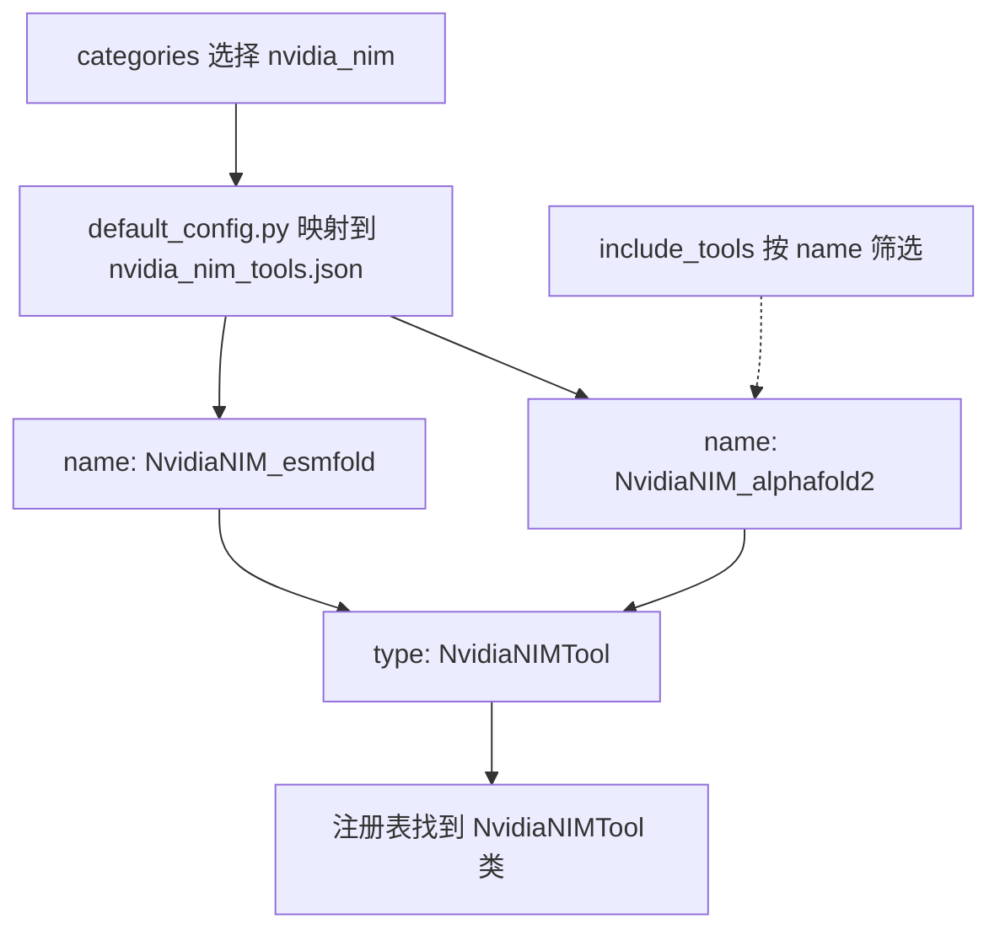

# ToolUniverse 的 category type 和 name

以 NVIDIA NIM 工具为例：`categories` 选择要读取的配置文件，`include_tools` 按 JSON 中的 `name` 选择具体工具，JSON 顶层的 `type` 指定执行工具的 Python 类。

| 概念 | 本例中的值 | 对应位置与作用 |
| --- | --- | --- |
| category | `nvidia_nim` | `default_tool_files` 的键，映射到 JSON 文件 |
| name | `NvidiaNIM_alphafold2` | JSON 中一个具体工具的名字，加载筛选和调用时使用 |
| type | `NvidiaNIMTool` | JSON 中的实现类型，匹配 `@register_tool(...)` 的注册名 |
| include_tools | `["NvidiaNIM_alphafold2"]` | `load_tools()` 的筛选参数，匹配工具的 `name` |

先看 [default_config.py](../../ToolUniverse/src/tooluniverse/default_config.py) 中的映射：

```python
default_tool_files = {
    # 其他分类省略
    "nvidia_nim": os.path.join(current_dir, "data", "nvidia_nim_tools.json"),
}
```

这里的 `nvidia_nim` 就是 category。因此，`categories=["nvidia_nim"]` 会选中 `data/nvidia_nim_tools.json`。分类名与文件路径由这个字典关联，分类名不必等于文件名。

打开 [nvidia_nim_tools.json](../../ToolUniverse/src/tooluniverse/data/nvidia_nim_tools.json)，可以看到多条工具配置。下面只保留与对应关系有关的字段，输入参数等字段已省略：

```json
[
  {
    "name": "NvidiaNIM_alphafold2",
    "type": "NvidiaNIMTool",
    "fields": {
      "endpoint": "deepmind/alphafold2"
    }
  },
  {
    "name": "NvidiaNIM_esmfold",
    "type": "NvidiaNIMTool",
    "fields": {
      "endpoint": "nvidia/esmfold"
    }
  }
]
```

两个工具的 `name` 不同，调用的 endpoint 也不同，但 `type` 相同，所以共用同一个 Python 实现类。每条配置仍有自己的 `parameter`，分别定义该工具接收哪些输入。

在 [nvidia_nim_tool.py](../../ToolUniverse/src/tooluniverse/nvidia_nim_tool.py) 中，实现类这样注册：

```python
@register_tool("NvidiaNIMTool")
class NvidiaNIMTool(BaseTool):
    # 构造函数读取该工具配置中的 fields
    # run(arguments) 执行相应的 API 请求
    ...
```

**JSON 的 `type` 必须匹配装饰器里的注册名。** 本例中注册名和类名都是 `NvidiaNIMTool`；框架使用注册名查找类。

category 和 type 通过 JSON 中的工具条目关联：一个分类包含一组配置，每条配置再指定实现类。本例中的工具恰好都使用 `NvidiaNIMTool`；框架也允许一个分类内出现多种 type，或者多个分类复用同一个 type。



下面是只加载 AlphaFold2 配置的示例。假设当前环境已安装 ToolUniverse，并通过环境变量配置了 `NVIDIA_API_KEY`；这个分类声明了该凭据，缺少时工具会在加载阶段被过滤。

```python
from tooluniverse import ToolUniverse

tu = ToolUniverse(load_workspace=False)
tu.load_tools(
    categories=["nvidia_nim"],              # 匹配 default_tool_files 的键
    include_tools=["NvidiaNIM_alphafold2"],  # 匹配 JSON 中的 name
    clear_existing=True,                    # 清除先前配置，只保留本次选择
)

config = tu.all_tool_dict["NvidiaNIM_alphafold2"]
print(config["name"])                # NvidiaNIM_alphafold2
print(config["type"])                # NvidiaNIMTool
print(config["fields"]["endpoint"])  # deepmind/alphafold2
```

这段代码加载并查看配置，不发起模型推理。真正调用时，仍然使用具体工具的 `name`：

```python
tool_call = {
    "name": "NvidiaNIM_alphafold2",
    "arguments": {
        "sequence": "MVLSPADKTNVKAAWGKVGAHAGEYGAEALER",
        "algorithm": "mmseqs2",
        "databases": ["small_bfd"],
    },
}

# 取消注释后才会向 NVIDIA 发起实际请求：
# result = tu.run_one_function(tool_call)
```

`include_tools` 支持多个名字，也支持通配符。例如 `["NvidiaNIM_alphafold2*"]` 可以选择单体版和 multimer 版。省略 `include_tools` 时，会加载所选分类中的工具，再应用凭据要求等其他过滤条件。

如果要按 JSON 顶层的 `type` 筛选，应使用 `include_tool_types=["NvidiaNIMTool"]`。注意，旧参数 `tool_type` 是 `categories` 的弃用别名，不能把它当成 JSON 的 `type` 筛选器。

完整 JSON 中还有 `parameter.type: "object"`、`properties.sequence.type: "string"` 等字段。这些表示输入数据类型；只有工具配置顶层的 `type: "NvidiaNIMTool"` 用于选择实现类。

在 [execute_function.py](../../ToolUniverse/src/tooluniverse/execute_function.py) 中，可以按函数名找到对应实现：

| 函数 | 负责的步骤 |
| --- | --- |
| `load_tools()` | 根据 categories 读取配置文件 |
| `_filter_and_deduplicate_tools()` | 根据 name、type 和凭据条件筛选工具 |
| `init_tool()` | 根据配置的 type 查找实现类，并传入该条工具配置 |
| `run_one_function()` | 根据调用中的 name 找到具体工具并执行 |
